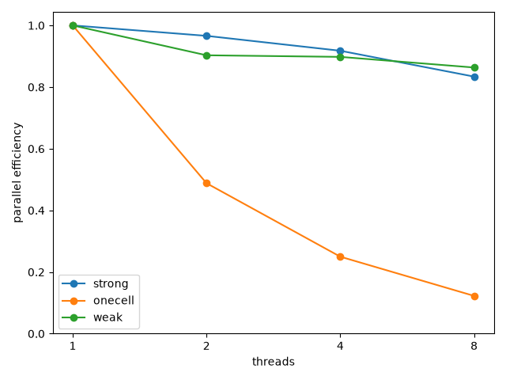

#+TITLE: Measure CPU scaling of batch evaluation
#+OPTIONS: toc:nil todo:nil num:nil author:nil title:nil

* Measure CPU scaling of batch evaluation

=scripts/cpu_scaling.py= times =evaluate_batch= at each thread count.
It writes three tables as CSV.
It runs only when called, and it changes nothing in the library.

- =strong.csv= keeps the batch fixed and adds threads.
- =onecell.csv= gives one large periodic cell to every thread count.
- =weak.csv= gives every thread the same number of cells.

Each sample is one whole =evaluate_batch= call from Python.
That covers the input copies, one potential per worker and the pairs.
It also covers starting and joining the threads and the output arrays.
After every call the energy and forces are compared bit for bit.
The reference is a 1-thread call on the same cells.
The =match= column records the result.

** Run it

Build with meson and make the =rgpot= package importable.
One way is =meson install= with =--destdir=.
The harness reads the compiler and the build options from the build.
It finds them in the =meson-info= directory.

#+begin_src bash
python scripts/cpu_scaling.py --build-dir build --out results \
    --plot cpu_scaling.png
#+end_src

=--threads= picks the thread counts, and 1 is always added.
=--repeats= sets the timed calls per row, and it must be at least six.
The exit status is 1 when any row does not match the 1-thread call.

** Read the tables

Every file starts with =#= lines.
They give =uname -m= and the CPU model from =lscpu=.
The core count comes from =env -u OMP_NUM_THREADS nproc=.
The compilers and the build options follow.
The last lines give the Python, NumPy and rgpot versions and the device.

The columns =median_s=, =q1_s= and =q3_s= are the quartiles.
=iqr_s= is =q3_s= minus =q1_s=.
The quartiles use the inclusive method of =statistics.quantiles=.
It interpolates linearly, as the NumPy default does.
In the strong and one-cell tables, =speedup= is the 1-thread median.
It is divided by the median of the row.
=efficiency= is =speedup= over the thread count.
In the weak table, =efficiency= is the 1-thread median over the median.
There =speedup= is =efficiency= times the thread count.
That is the throughput ratio.

** The constants

- The cells are Pt fcc with a lattice parameter of 3.92 Angstrom.
  It is in Kittel, Introduction to Solid State Physics, 8th ed., ch. 1.
  The =pt-bulk= system of =time_pair_scaling= uses the same value.
- The potential is =MorsePot= with its platinum defaults.
  So the call takes the linkcell and minimage pair list.
  Nothing is tuned for this system.
- A batch cell is 5 x 5 x 5 conventional cells, 500 atoms.
  Its edge of 19.6 Angstrom is more than twice the 9.5 Angstrom cutoff.
  Minimum image needs that, and four repeats would be too small.
- The one-cell table uses 14 x 14 x 14 cells, 10976 atoms.
  Fourteen is the smallest repeat with at least 10^4 atoms.
  That is the size of the bulk cell in =tests/python/test_scaling.py=.
- Sites move by normal deviates of standard deviation 0.015 Angstrom.
  Cell =i= uses the seed =1000 + i=.
  Both choices follow the Pt7 frames of =test_scaling.py=.
  A perfect lattice would give zero forces and a weak comparison.
- Each worker gets 8 cells.
  On the host below, a width-8 call on two-atom cells cost 148 us.
  One 500-atom cell cost 0.69 ms on one thread.
  Eight is the smallest power of two that keeps 148 us under 5 percent.
  The 5 percent is the noise floor in =benchflow/export_results.py=.
  The strong batch is 8 times the largest thread count.
  So the widest strong row and the widest weak row run the same cells.
- The thread counts are the powers of two up to the core count.
  The core count itself is added when it is not a power of two.
- Seven timed calls per row is the smallest odd count of at least six.
  So the median is one of the samples.
  One more untimed round runs first, as the asv warm-up does.
  In a fresh process the first 10976-atom call took 140 ms.
  Later calls took about 9 ms.
  The thread counts are interleaved within each round.
  So drift on the host spreads over every row.

** Results on one host

The host was an 8-core x86_64 virtual machine under KVM.
=lscpu= names the CPU =Intel(R) Xeon(R) Processor=, one thread per core.
The build was a release build with GCC 13.3.0.

#+CAPTION: Parallel efficiency against thread count, from one run of
#+CAPTION: =scripts/cpu_scaling.py= on the 8-core host.

The strong batch of 64 cells took 44.2 ms on one thread.
On eight threads it took 6.63 ms, an efficiency of 0.83.
The weak rows stayed between 5.69 and 6.59 ms.
That is an efficiency of 0.86 at eight threads.
The one-cell row took about 9.1 ms at every thread count.
=BatchEvaluator= gives each configuration to one worker.
The binding starts no more workers than there are configurations.
So a single cell does not split.
Every row matched the 1-thread call.

** Other devices

The harness looks up its evaluator in the =DEVICES= mapping.
The key is the =--device= name, and only =cpu= is there today.
A GPU backend adds an entry with the same signature.
The tables, the header and the 1-thread comparison stay the same.
